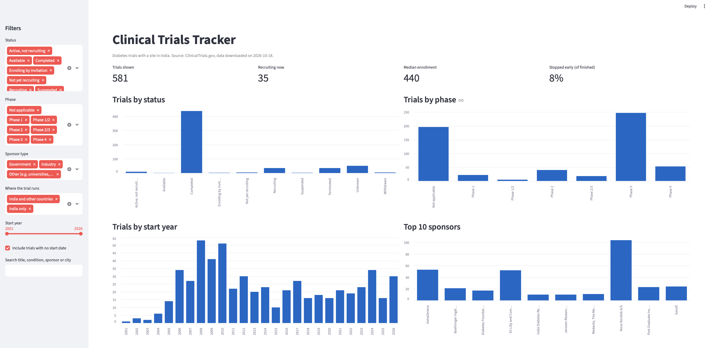
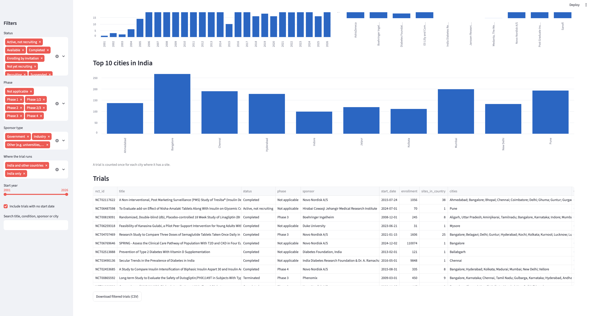
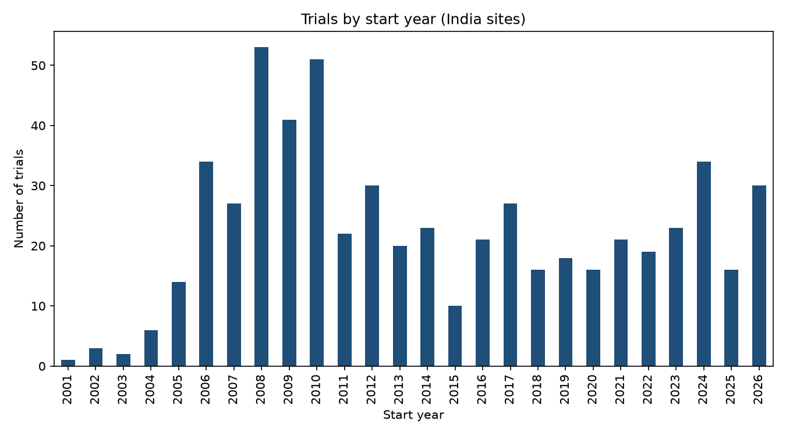
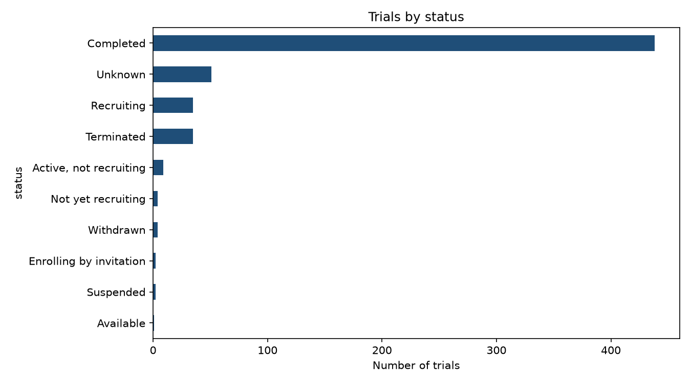
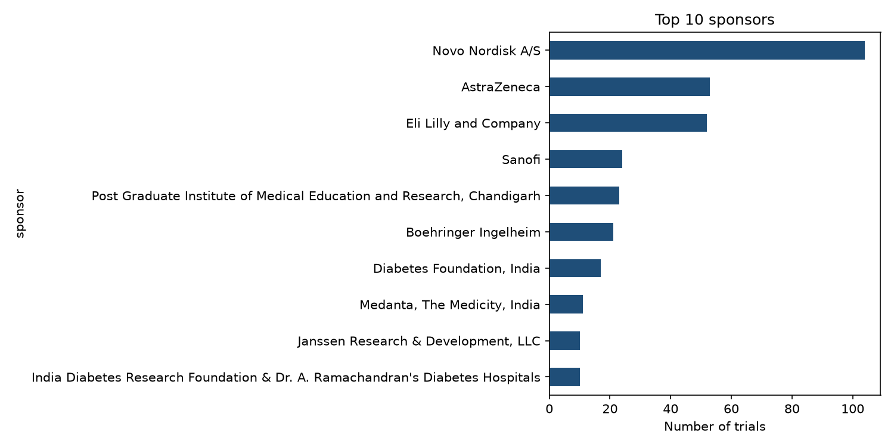
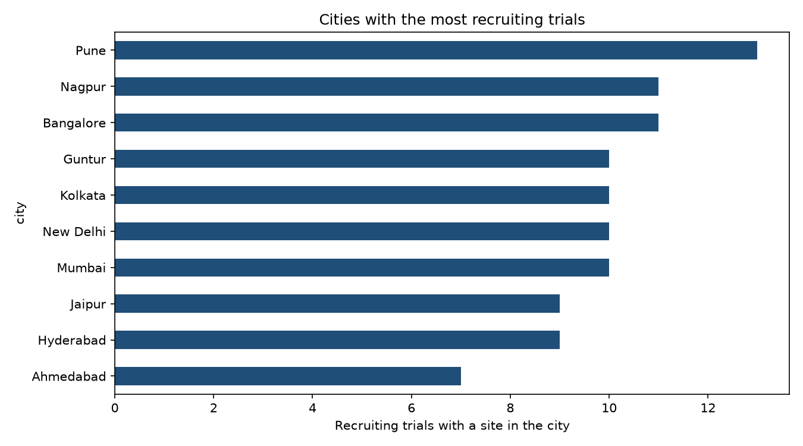
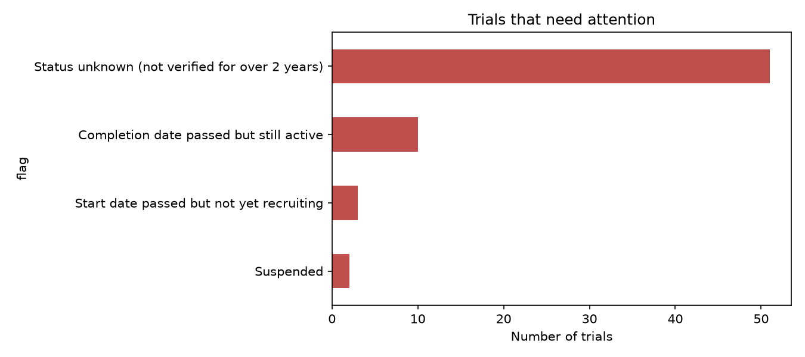
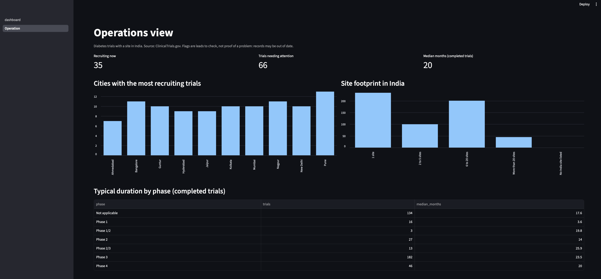
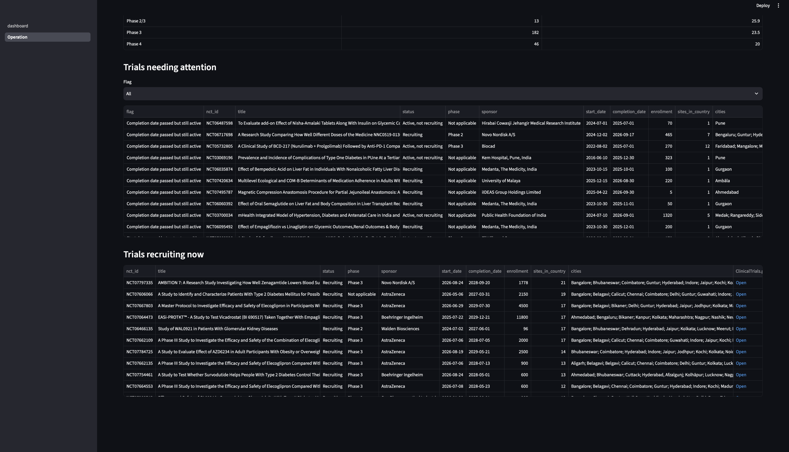

# Clinical Trials Tracker

Python tools that download clinical trial records from ClinicalTrials.gov and
analyse them like a clinical operations team: trials by status, phase, sponsor,
and location.

Current focus: **diabetes trials with a site in India**.

Data source: [ClinicalTrials.gov](https://clinicaltrials.gov), a service of the
U.S. National Library of Medicine. The data is a snapshot taken on the date
shown in `data/trials.csv` (column `downloaded_on`) and changes over time.

## Status
- [x] Phase 1: Download trial data
- [x] Phase 2: Clean and analyse
- [x] Phase 3: Dashboard
- [x] Phase 4: Operations view
- [x] Phase 5: Findings report

## How to run
1. `pip install -r requirements.txt`
2. `python fetch_trials.py` downloads the trials into `data/trials.csv`
3. `python analyze_trials.py` cleans the data and creates summary tables and charts
4. `streamlit run dashboard.py` opens the dashboard
5. `python operations_view.py` creates the operations tables and charts
6. `python make_report.py` writes the findings report to `docs/findings_report.md`

## Dashboard

`dashboard.py` is a Streamlit app for exploring the trials. You can filter by
status, phase, sponsor type, where the trial runs and start year, search by
text, open any trial on ClinicalTrials.gov, and download the filtered list.

## Analysis

`analyze_trials.py` cleans the downloaded data and produces summary tables in
`output/` and charts in `images/`.

## Operations view

`operations_view.py` answers questions a clinical operations team would ask:
which trials are recruiting now and where, which trials need attention (a
completion date that has passed while the trial is still active, a start date
that has passed while it is still "not yet recruiting", an unknown or
suspended status), how long completed trials take, and how large the site
footprint is. The results appear on the Operations page of the dashboard.

**Limits:** flags are leads, not proof. Registry records can simply be out of
date. Trial duration is measured from the registered start date to the
registered completion date, which may be planned dates.

## Key findings

Full report: [docs/findings_report.md](docs/findings_report.md)

1. **Most trials are finished.** 438 of 581 trials (75%) are completed, and 35 are recruiting now.
2. **Sponsors.** 406 trials (70%) have an industry lead sponsor. The three most frequent sponsors are Novo Nordisk A/S (104), AstraZeneca (53), Eli Lilly and Company (52).
3. **Global and local trials.** 246 trials (42%) run only in India. 335 (58%) also have sites in other countries.
4. **Early stopping.** Of 477 finished trials, 39 (8%) were terminated or withdrawn.
5. **Operations.** Cities with the most recruiting trials: Pune (13), Bangalore (11), Nagpur (11). 66 trials (11%) have at least one flag that deserves a closer look.

These numbers are a snapshot of the registry on the download date shown in the full report.